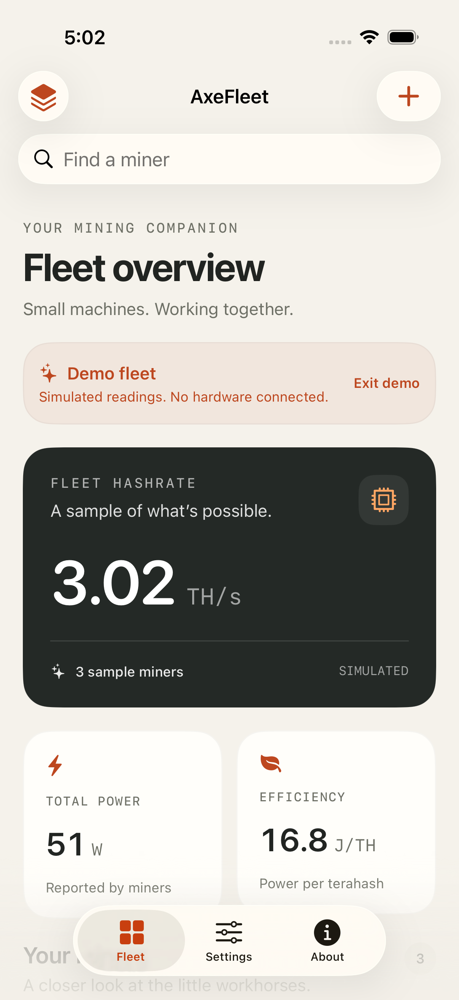
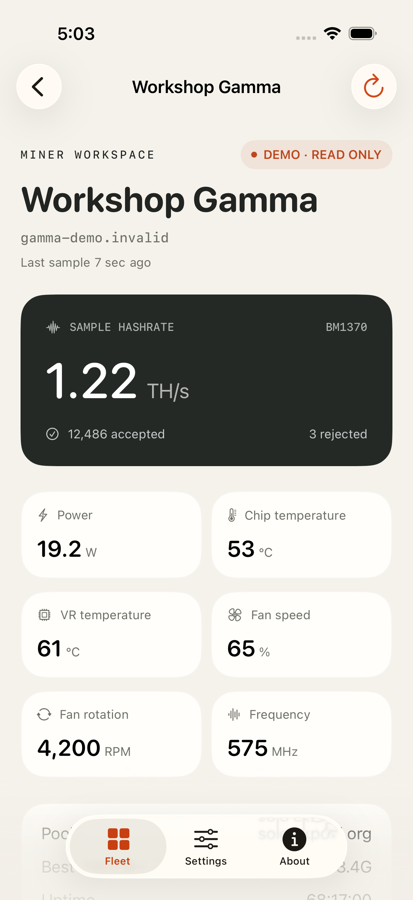
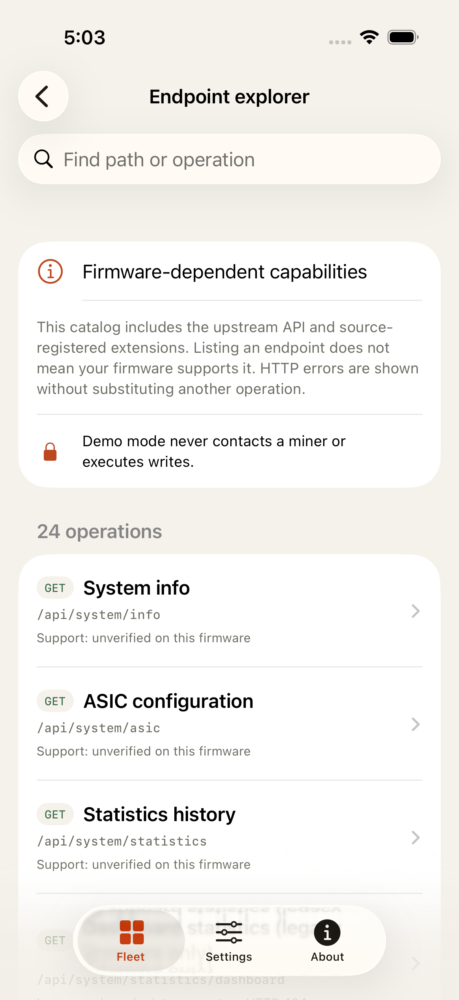

# Native app validation

Validated September 6, 2026 using Xcode 26.6, Swift 6 language mode, and the iPhone 17 Pro simulator running iOS 26.5. Deployment target is iOS 17 for iPhone and iPad. This report complements the independently audited [core API validation](VALIDATION.md).

## Reproduced results

- `swift test`: **41 core test functions passed**, including parameterized URL/endpoint/payload checks. See the core report for its expanded invocation count and release-build checks.
- Unsigned iOS simulator app build: **passed**.
- Expanded full `xcodebuild test` run: **98 passed, 0 failed, 0 skipped**. This consists of 90 Swift Testing app test functions and 8 XCTest UI tests. The result includes 228 parameter-expanded invocations.
- The expanded full result bundle is local build output at `build/Logs/Test/Test-HashFleet-2026.09.06_17-02-44--0400.xcresult`. It is intentionally not committed. The original pre-widget baseline had 23 native tests. Screenshots below are exported from passing simulator tests.
- Info.plist and privacy manifest passed `plutil -lint`.
- No third-party runtime dependencies were installed or linked.

The 139 total test functions across the package and app are not a claim of 112 physical-device scenarios. Core requests and application state tests use mocked transports. UI tests use isolated preferences with explicit demo mode, a loopback-only HTTP fixture, or a separately named sample ActivityKit activity.

## October 3, 2026 menu bar and Mac layout regression

- `swift test` passed **198 tests in 23 suites**.
- The complete `HashFleetTests` native unit target passed **695 tests in 71 suites** on the iPhone 17 Pro simulator running iOS 26.4.1. This includes the new menu visibility, shared snapshot privacy/round-trip, and sidebar-aware adaptive layout tests.
- A clean unsigned Release build of the `HashFleetMenuBar` macOS scheme succeeded.
- The full app scheme was also exercised with serialized UI testing. It continued through passing UI cases until the command reached the 600-second execution cap; no source or test failure was observed before the timeout. The completed unit target above is the final automated pass claim, not a claim that the capped full UI run finished.
- Live Mac acceptance verified wide, medium, and compact app layouts, one persistent system menu item, the explicit show-or-hide toggle, a fixed popover anchor during changing telemetry, compact rows for four miners, a single stable companion process, a valid installed signature, and a plist accepted by `plutil`.
- The menu snapshot is presentation-only. Tests reject URL, pool, password, wallet, and seed markers from the encoded compact cache. The companion does not poll miners or send hardware changes.

## Native state and safety checks

- Demo mode performs no HTTP requests, never opens WebSockets, retains separate fixture history, and restores the real saved inventory when left.
- Online/offline miners produce correct fleet totals and visible errors. Failed polls do not create fabricated telemetry.
- Invalid or duplicate addresses cannot replace a real fleet or inadvertently exit demo mode.
- Adding/removing miners persists identity and addresses. Blank display names fall back to the host.
- Corrupted stored data is reported and preserved. Before a later write, it is copied into a unique `app.hashfleet.devices.v1.recovery.<UUID>` preference entry.
- Caller cancellation and entering demo mode cancel owned in-flight HTTP work and reject stale results. Add/exit-demo functions do not spawn hidden refresh tasks.
- Every catalog mutation is classified for confirmation, including all pool slots. JSON must be a nonempty object and remain within the 256 KiB app limit.
- Hardware-risk fields and firmware/boot operations trigger enhanced warnings. Password fields are redacted in the confirmation preview without changing the bytes sent.
- Raw responses remain in memory until the user explicitly prepares an export. Exports use complete file protection and are cleaned up on the next request or when leaving the endpoint view. Export failures do not change a successful device operation into an apparent failed mutation.
- Missing/null/negative-sentinel sensor readings are not presented as measured zero. Legitimate zero fan speed and negative Wi-Fi RSSI remain distinguishable.

## UI acceptance

1. Launch a labeled sample fleet, inspect its native dashboard, navigate to About, and return to Fleet.
2. Open the native add-miner sheet, enter a URL containing an API path, observe validation rejection, cancel, and return to onboarding.
3. Open a sample miner, navigate to the full endpoint explorer, search for restart, and confirm the send button is disabled in demo mode.
4. Launch with the largest accessibility content-size category, open and dismiss Add a miner, scroll to a sample miner, and open its detail. Exported screenshots confirm enlarged text is actually applied. This checks navigation reachability and text reflow, not every screen or VoiceOver behavior.
5. In real app mode, add an in-process HTTP fixture bound only to `127.0.0.1`, read its telemetry, create a hostname draft, cancel review, reject an empty JSON object, and prove token-only and acknowledgment-only states cannot send. The final explicit confirmation produces exactly one PATCH with only the expected hostname field, followed by a telemetry GET. No physical miner is used.
6. In demo mode, select a frequency change, prove the additional tuning-risk acknowledgment is required, verify the review contains only the frequency key, and confirm the final request remains locked by demo mode.
7. Start a genuine ActivityKit activity from the Settings tab using a separately named sample namespace and no shared cache. Verify the started state, capture the Home Screen's actual Dynamic Island showing DEMO, sample hashrate and capture time, return to the app, and end the activity. This passed on the simulator, not on a physical device.

8. Open Fleet preferences, enable compact cards, return to Fleet, search for a named sample miner, open its details, and return to Settings with the preference retained. Sorting tests independently cover missing, nonfinite, negative and offline readings, genuine zero, exact large counters, persistence, interval bounds and stable ties.

The loopback test initially tapped inert switch-label space and later looked for a response below a lazy Form viewport. Targeting the switch thumb, asserting its actual value, and scrolling to the response fixed those test-interaction failures without weakening the write gate.

The widget extension builds as an embedded native extension. Snapshot tests cover aggregate-only encoding, corrupt data, exact freshness boundaries, clock skew, unavailable App Groups, opt-in isolation and cache clearing. Native tuning tests cover explicit field selection, finite/integer encoding, audited firmware bounds, omitted protection fields and full pool-slot replacement acknowledgment. The pool form sends the firmware password-retention sentinel when replacement is off and warns that omitted advanced PUT fields reset.

An initial UI test exposed the collapsed default search placement on iOS 26. The explorer now requests an always-visible navigation search field, and the test passes. Earlier integration builds caught a malformed plist and an incomplete worker file set. Both were fixed before the successful builds. A safety-test declaration typo was also corrected before the final suite passed.

Xcode emitted local debugger-version discovery diagnostics, but the final result bundle reports all tests passed. These diagnostics were not source compiler errors.

## Screenshots

All readings shown are explicitly labeled sample data, not connected hardware.

| Fleet | Miner | API explorer |
| --- | --- | --- |
|  |  |  |

[Demo write safety lock](screenshots/demo-write-lock.png) · [Fleet preferences](screenshots/fleet-preferences.png) · [Grouped miner settings](screenshots/miner-settings.png)

## Remaining release gates

- Real miner HTTP reads were verified as described below. No miner was modified. Physical-iPhone permission prompts, mDNS reachability, older firmware behavior, and actual miner WebSocket streams still need device acceptance.
- Firmware uploads, boot changes, thermal settings and pool writes have not been run against hardware. Board/image compatibility, power-loss recovery and successful firmware boot cannot be established with mocks.
- The native confirmation sheet's final send gesture has not been exercised against a physical miner. The simulator validates a complete hostname write over real loopback HTTP, the demo lock and tuning review. This does not establish the electrical safety of any clock, voltage or cooling combination.
- No iPad, iOS 17 runtime, or VoiceOver device session has been executed. Maximum Dynamic Type navigation was tested on the iPhone simulator as described above, but this is not a full accessibility certification.
- A signed development build was installed on the user's iPhone as described below. No distribution archive, TestFlight upload, App Store submission or public GitHub publication was performed. CI is configured, not remotely run.
- The user subsequently registered the App Group in Xcode, and both signed binaries were verified to carry only `group.app.hashfleet.shared`. Widget gallery installation, every family layout, system redaction and stale presentation still require system/device acceptance. See [WIDGETS.md](WIDGETS.md).
- Continuous background monitoring, system notification alerts, automated discovery and persistent historical storage are not included. Fleet performs a complete read-only HTTP snapshot when opened, optionally keeps a live read-only WebSocket while active, and falls back to HTTP when a stream is unavailable. A newly improved per-miner best share gets an in-app celebration while Fleet is open. It retains a bounded in-memory chart history.

## User-authorized read-only hardware follow-up

After the automated runs, the user provided two LAN addresses for live connection. At approximately 15:48–15:50 local time, both responded successfully to `GET /api/system/info`:

- Board **602**, ASIC **BM1370**, firmware `v2.15.2rc0-41-g274c11b`.
- Board **601a**, ASIC **BM1370**, firmware `v2.15.2rc0-44-g736011e`.

The addresses were saved only to the installed simulator app's real fleet preferences, not into source code, fixtures, or committed screenshots. The app was launched without `--demo` or `--ui-testing`. The actual native dashboard showed **2 of 2 online**, about **2.54 TH/s combined**, and about **40 W reported power**, with a fresh last-update label. Values are instantaneous and naturally change. Device sensor power is not an independent wall-power measurement.

No PATCH, PUT, DELETE, restart, identify, pause/resume, boot, or OTA requests were sent to either miner. No firmware, pool configuration, fan setting, clock, voltage or protection state was changed. This establishes direct native URLSession read/polling compatibility with those two devices from the simulator, not physical-iPhone network permission behavior or full endpoint execution coverage. Private live screenshots remain in ignored local build output, while committed screenshots show only sample data.

## User-requested iPhone installation

At approximately 16:26 local time, the signed development app and embedded extension were installed and launched successfully on the connected iPhone 14 Pro Max running iOS 26.6.1. The two user-supplied miner addresses were placed only in the new app's device preferences before its first launch. Local Network permission and actual on-phone telemetry still need the user's confirmation.

The available Apple development profiles did not authorize the requested shared App Group. The phone build therefore used an ignored, local empty-entitlements override for both targets. Monitoring, native settings and local Live Activities are included, but widget sharing is deliberately unavailable in that build. The checked-in project retains the App Group configuration for properly provisioned builds. No private signing team, provisioning profile, certificate, phone identifier or miner inventory was added to source.

At approximately 16:32, the user completed App Group setup in Xcode. A full signed build then succeeded without the fallback. An unrelated app's group had also been selected and was removed from HashFleet's entitlements. Both resulting signed binaries were inspected to confirm exactly the intended HashFleet group. The user's development team is retained in ignored `Signing.local.xcconfig`, loaded by the public `Signing.xcconfig`, so regenerating the project does not discard local signing or publish that team setting.

The subsequent UX refinement divides miner settings into General, Cooling, Display and Pools, with separate Manual tuning and Advanced tools destinations. The miner detail's expert tools start collapsed. App Settings contains three focused destinations: Fleet preferences, Widgets and Live Activity, with longer explanations inside disclosures. Fleet preferences control the app polling interval, sorting and compact cards. Useful firmware Swarm parity additions include on-device statistics and automatic fan minimum, with each reviewed separately.

At approximately 17:03, the latest full App Group-enabled development build was installed successfully on the same iPhone, preserving its existing app preferences. Both the app and embedded widget extension passed signature verification and were checked for exactly the HashFleet shared group. The subsequent remote launch was denied specifically because the phone was locked. Opening the installed update, local-network permission, actual telemetry, widget sharing and widget-gallery behavior on that phone remain user/device acceptance steps. No miner-setting writes were performed.

## Final Swarm-settings regression

The 17:02–17:06 full run passed after integrating fleet preferences, local search, compact cards, statistics logging and automatic fan minimum. The firmware audit established a 0–99% minimum-fan wire bound, distinct from the 0–100% manual-fan bound. Each new setting emits only its own key. Statistics logging does not trigger a clock-tuning warning, while minimum fan speed still receives the hardware warning. Native tests validate that distinction and keep every write on the confirmation path. Display hardware type and thermal-protection flags remain outside the friendly form. See [Swarm settings parity](SWARM-SETTINGS-PARITY.md).

## Model-aware compatibility regression and phone update

For named requirement checks, actual native real-miner UI observations, per-output limits, and the subsequent whole-result rerun, see [ACCEPTANCE-MATRIX.md](ACCEPTANCE-MATRIX.md). Aggregate counts below do not establish every model, every screen state, or physical-iPhone acceptance.

The subsequent 2026-09-06 audit rechecked pinned ESP-Miner commit `2943d206f6c8a4b249bc74c820fb56c874ac316d`. Upstream was unchanged from the original endpoint inventory. Improvements therefore focus on compatibility checks, field-driven native controls, and accurate presentation rather than claiming newly discovered endpoints. See [second firmware audit](SECOND-FIRMWARE-AUDIT.md) and [model capability matrix](MODEL-CAPABILITY-MATRIX.md).

OpenAI, Claude, and Antigravity workers contributed audit, implementation, and review work. An additional automatic-route worker failed, so NVIDIA NIM is **not verified provider coverage**. The Claude worker delivered changes before a later HTTP 429 rate-limit failure. The coordinator integrated and tested the resulting source. This was a multi-provider run, not successful execution by every configured provider.

### Final automated evidence

- Swift package suite: **61 test functions in 7 suites passed**.
- Final native run at **17:49–17:53 local time**: **137 test functions passed**, **267 expanded executions**, zero failures and zero skips, on iPhone 17 Pro simulator with iOS 26.5. The local result is `build/Logs/Test/Test-HashFleet-2026.09.06_17-49-10--0400.xcresult`. Xcode's debugger-version diagnostics did not prevent a passing result.
- Compatibility UI acceptance uses a real IPv4-loopback HTTP server and native URLSession. Opening the screen sends no ASIC request. Deliberate checks cover an ASIC 404 with successful Info, a typed unknown model, authentication failure without leaked response text, malformed payload retry, and demo mode with no fabricated success. The request journal permits only GET Info/ASIC and contains no writes.
- Probe/store tests cover exact endpoint boundaries, partial results, 404/405/501 versus authentication/server/transport failures, typed payload validation, cancellation, report replacement, removal, and demo isolation. The initial cancellation failure was fixed by propagating cancellation into the child probe task and preventing late report publication.
- Native polling tests use isolated URLProtocol transport, not test-only production snapshot setters. Empty/error-only Info stays offline. Recognizable partial Info can be online without inventing missing hashrate or power. Subtotals disclose coverage, efficiency requires complete paired metrics, and incomplete readings are not published as complete widget/Live Activity totals.
- Existing native navigation, large text, settings review, demo write lock, explicit loopback write confirmation, tuning-risk acknowledgement, widgets, and ActivityKit tests remained in the full regression.

### Physical read-only checks

At approximately 17:19 local time, the native core probe successfully read **both Info and ASIC on both user-authorized miners**:

| Board | Reported ASIC device model | ASIC | Firmware | Info / ASIC |
| --- | --- | --- | --- | --- |
| 602 | Gamma | BM1370 | `v2.15.2rc0-41-g274c11b` | Supported / Supported |
| 601a | GammaV2 | BM1370 | `v2.15.2rc0-44-g736011e` | Supported / Supported |

Models above are verbatim firmware reports, not inferred board identities. ASIC options remain firmware-reported references, never safe tuning recommendations. These two devices do not establish support for every board or firmware version. Private addresses and raw local evidence remain outside committed source. No miner settings, pools, fan speeds, clocks, voltages, protection flags, firmware, or boot state were changed.

### Signed update

At approximately **17:57 local time**, the final development app was installed successfully on the user's iPhone, preserving its existing preferences. The app and embedded widget extension both passed signature verification and carried exactly `group.app.hashfleet.shared`. The following remote launch was denied because the phone was locked. Opening the installed app, confirming on-phone telemetry and local-network permissions, and exercising physical widget-gallery behavior remain device acceptance steps. There was no TestFlight upload, App Store submission, or public repository publication.

### Rendered-output follow-through

The final whole-result rerun at **18:32–18:39 local time** passed **61 core functions and 139 native functions / 269 expanded executions**, with zero failures or skips. Every one of the **67 distinct named checks in the 22-row acceptance matrix** was matched to an explicit Passed result. This supersedes the earlier regression counts, not the documented hardware/provider limits.

The two added native acceptance tests observed missing-field explanations across General/Cooling/Display, preserved reported drafts, cached ASIC references without a second probe, explicit frequency copying with review still locked, independent catalog support labels, and UNAVAILABLE / LAST KNOWN HASHRATE after an actual HTTP 503 poll. Compatibility check time is now exposed as one combined accessibility element, verified in the native hierarchy alongside its historical-reference explanation. Real-miner foreground monitoring and the deliberate compatibility button were independently observed in the native app as recorded in LIVE-1 through LIVE-3.

At **18:40 local time**, the signed update containing the timestamp accessibility improvement installed successfully on the user's phone. Both app and widget extension had valid signatures and exactly the intended shared App Group. Remote launch was again denied specifically because the phone was locked. No phone-unlock bypass, real miner write, public upload, or physical widget-gallery acceptance was performed.
