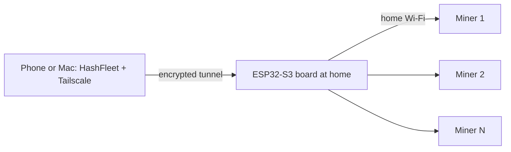

# Remote access with Tailscale

HashFleet talks directly to your miners over their home network addresses. It has no cloud relay, and miner APIs are unencrypted HTTP, so **never port-forward a miner to the internet**. To check your fleet away from home, put your phone or Mac on a private VPN that can reach the miners. This page describes the setup we use and validated: Tailscale with a small ESP32 board acting as the bridge.

Validated November 9, 2026: with Tailscale on, the HashFleet iPhone app reached and controlled four miners over cellular data. With Tailscale off, they were unreachable.

## Option 1: An ESP32-S3 board as the bridge (no computer needed)

**Repository:** [SMWARREN/esp32-tailscale-subnet-router](https://github.com/SMWARREN/esp32-tailscale-subnet-router), with firmware, setup steps, credits and license details.

A $20-class ESP32-S3 board stays at home on Wi-Fi, joins your Tailscale network, and forwards traffic to the miners. HashFleet keeps using the miners' normal home addresses. No router changes, port forwarding or always-on computer are needed.

### What you need

| Item | Details |
| --- | --- |
| Board | ESP32-S3 **with PSRAM**. Tested: Hiwonder "ESP32S3 Large Model Board" (ESP32-S3-WROOM-1-N16R8, 16 MB flash, 8 MB PSRAM, 2.0" touchscreen) |
| Tailscale | Free personal account, plus the Tailscale app on each phone or Mac |
| Build tools | `arduino-cli` with Arduino-ESP32 core 3.3.0, and a USB cable |
| Tailscale client on the board | [MicroLink](https://github.com/CamM2325/microlink), an independent open-source Tailscale-compatible client (MIT), packaged as an Arduino library with fixes in the repository above |

The display, touch and audio code is specific to the Hiwonder board. The Tailscale and routing parts should work on any ESP32-S3 with PSRAM after you adjust the pins.

### How it works

- The board advertises **one `/32` route per miner**, so only those exact addresses are reachable over Tailscale. The rest of your home network is not exposed.
- It forwards tailnet traffic onto Wi-Fi with NAT, so miners see requests coming from the board and need no configuration changes.
- It serves a small read-only status page on its Tailscale address.

### Setup summary

Follow the repository README for exact commands. In short:

1. In the Tailscale admin console, create a **reusable auth key**. Put it in the firmware's `secrets.h`, which must never be committed.
2. Edit the miner list in the firmware to your miners' home IP addresses.
3. Build and flash the board over USB. Back up the board's flash first.
4. On first boot, join the **FleetMonitor-Setup** hotspot and choose your home Wi-Fi.
5. In the Tailscale admin console, open the board under **Machines**, choose **Edit route settings**, and approve the miner routes. On the same menu, choose **Disable key expiry** so the board isn't logged out when its key expires (180 days by default).
6. Install Tailscale on your phone or Mac, sign in to the same account, and leave it on. In HashFleet, keep using the miners' normal addresses.
7. Test: turn Wi-Fi off and Tailscale on, and HashFleet should show live readings. Turn Tailscale off, and miners should go offline.

## Option 2: An existing computer as the subnet router

If a Linux machine, Raspberry Pi or Mac is always on at home, you can make it the subnet router with the standard Tailscale client instead of an ESP32. Advertise only your miners' addresses, for example `tailscale up --advertise-routes=192.168.1.101/32,192.168.1.102/32`, then approve the routes in the admin console. See Tailscale's [subnet router guide](https://tailscale.com/kb/1019/subnets).

## Things to know

- **Security:** anyone in your tailnet can reach the miners' control pages. Keep the tailnet to your own devices, or use Tailscale access rules if you share it.
- **Speed:** away from home, traffic passes through the bridge, so controls respond more slowly than on your home Wi-Fi.
- **At home:** your phone may also route through the bridge. If it feels slow at home, turn off **Use Tailscale subnets** in the Tailscale app while home.
- **Scheduled push checks:** the iPhone's notification extension uses whatever route the phone currently has. With Tailscale connected, it can read miners away from home. Without a route, it shows an unavailable message instead. Apple controls delivery and timing.
- HashFleet does not install, operate or require Tailscale. Tailscale and MicroLink are third-party projects. MicroLink is not affiliated with or endorsed by Tailscale Inc.
