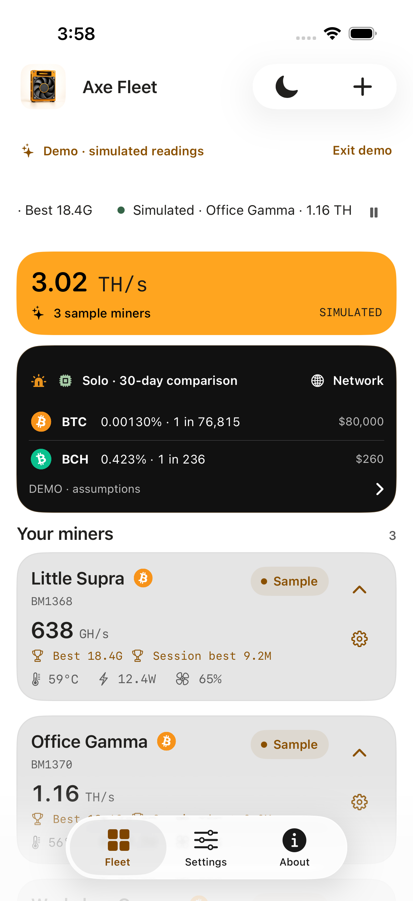
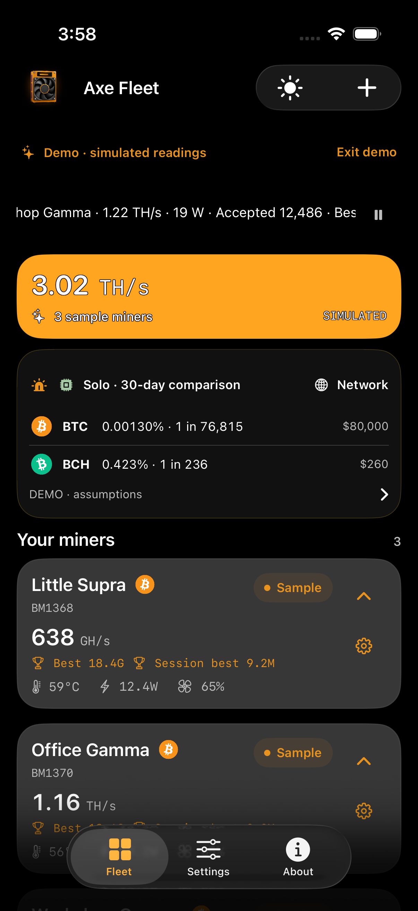

# White and black/graphite appearance · 2026-09-09

This supersedes the cream/bronze palette in `../logo-palette-2026/`. The latest user preference is a **clean white starting point in light mode**, a **black starting point with layered graphite in dark mode**, and continued use of the logo's gold and other material/status colors. It explicitly replaces the earlier no-white/no-black constraint.

## Current roles

| Role | Light | Dark |
| --- | --- | --- |
| Canvas | `#FFFFFF` | `#000000` |
| Fleet panels / standard surfaces | `#F5F5F5` | `#21201E` |
| Raised miner cards | `#E5E5E5` | `#373737` |
| Main text | `#21201E` | `#FFFFFF` |
| Secondary text | `#595959` | `#BDBDBD` |
| Action text | `#8A5000` | `#E9931E` |
| Hashrate panel | `#111111` | `#F5F5F5` |
| Hashrate primary / secondary text | `#FFFFFF` / `#BDBDBD` | `#111111` / `#595959` |
| Hashrate accent | `#E9931E` | `#8A5000` |
| Comparison / charcoal panel | `#111111` | `#111111` |
| Marquee background | None, white page shows through | None, black page shows through |

Gold is a restrained accent in hashrate cards and remains visible on controls. Metallic chart colors, functional sage status colors, warning gold, and original coin artwork remain intact. Light-mode small gold text is shaded for readability. This is not a monochrome theme, and graphite cards remain visibly separate from the black page.

The 06:09 UTC follow-up restored a missing gray layer in both modes. Individual miner cards use `raised`, previously an unused dashboard role. The subsequent 06:30 request adds more black in both modes through the near-black comparison panel, while preserving silver/graphite miner cards. The final 06:41 request removes the marquee background entirely so it blends into the white/black page. The logo and detail-only silence control are unchanged.

All 26 role pairs and their reasons are in `roles.json`. Source-image extraction remains recorded in `../logo-palette-2026/extracted.json`. White, black and neutral grays are intentional UI choices, not falsely claimed as sampled logo pixels.

```sh
python3 docs/research/neutral-palette-2026/build_palette.py
```

The current script checks every required pair without contrast waivers. Main hashrate text exceeds 17:1 in both modes, with separate neutral captions and small orange accents. See `../../ADAPTIVE-HASHRATE-2026-09-09.md` for the current palette and acceptance evidence.

## Logo surround fix

The decorative leading logo no longer receives the iOS 26 shared glass toolbar background. `.sharedBackgroundVisibility(.hidden)` removes that extra pale outline/capsule while leaving the actual light/dark artwork and 44-point frame unchanged. Earlier iOS versions retain their existing toolbar path. The appearance toggle and Add Miner controls keep native button styling.

The new white-background miner supplied at 21:28 UTC replaces the light header and Home Screen icon. Its content is unchanged, only resized for asset sizes. The existing dark artwork remains. A native centered launch storyboard uses the same adaptive header image and system light/dark background.

## Native examples and verification

The `screenshots/` examples below are historical. Current 21:42 UTC acceptance artifacts are in local scratch `HashFleetAdaptiveLoadingScreens`, with the manifest identifying each test and attachment.

| Light | Dark |
| --- | --- |
|  |  |

- Earlier neutral-base appearance run: `/Users/USER/.jcode/scratch/HashFleetNeutralPaletteFinal.xcresult`, completed 05:49 UTC. All **12 FleetPreferencesTests and 3 native UI tests passed**. Current gray-layer screenshots and checks come from the follow-up below.
- Exact unit checks cover the 23 role pairs, 62 contrast requirements, distinct resolved logo variants and appearance persistence. Native pixel checks explicitly require clean-white light canvas, black dark canvas and neutral light cards, as well as preserved mode switching, detail/settings/About navigation, ticker pause/resume and accessible static summaries.
- The first neutral run failed because the new strict canvas crop was actually inside the ticker padding. The final test samples the page gutter beside the hashrate card without lowering the black/white thresholds. That first run also had a paused-viewport mismatch despite byte-identical attached accessibility screenshots. Screenshot helpers now keep their backing buffers alive for the full drawing operation and attach the exact paused viewport crops. The full rerun passed with unchanged motion thresholds. No ticker production logic was changed.
- The isolated logo-rim change also passed native appearance tests before the palette was revised. Both final dashboard modes were visually inspected. The extra shared-glass surround is absent.
- The signed generic-iOS app/widget build and strict deep signature verification passed. iPhone installation and the subsequently requested detail-only silence control are tracked in the delivery follow-up below.
- This is targeted native acceptance, not a full regression suite or whole-app accessibility certification. Widgets and Live Activities compiled, but their system-controlled visual variants were not revalidated.

## Detail-only silence and iPhone delivery · 06:05 UTC

The fleet card no longer contains a silence button. Its notice remains informational and opens miner details through the existing card link. The detail warning card now offers a 44pt **Silence miner notice for 4 hours** control. Silencing hides the dashboard notice using the existing per-miner persisted deadline, while keeping the actual reported warnings visible in details and showing a silenced indicator. Returning to the dashboard refreshes the snooze state, reopening details retains it, and expiry makes the control eligible again. Firmware-update dismissal and miner settings are unchanged.

- Final notice acceptance: `/Users/USER/.jcode/scratch/HashFleetDetailNoticeFinal.xcresult`. **22 reported-state unit tests and the focused native notice UI test passed**, including the four-hour expiry check, no dashboard silence button, detail action, preserved warnings, return navigation and reopened silenced status.
- The first notice UI run exposed SwiftUI propagating the warning card's accessibility identifier onto the nested button. The card now explicitly contains separate accessibility children. The final test resolves the dedicated button/status identifiers and passes. This was fixed in production code, not bypassed by weakening the test.
- Before/after screenshots are `screenshots/detail-silence-control.png` and `screenshots/detail-silenced.png`. Their test/attachment IDs and hashes are in `screenshots/notice-manifest.json`.
- The final source was built for generic iOS, signed and passed strict deep signature verification.
- An earlier installation attempt failed to start the device service. Device information subsequently confirmed reconnection. The final build installed successfully on the paired **iPhone 14 Pro Max at 06:05 UTC**, and a normal launch of `app.hashfleet` succeeded at 06:05:50 UTC.
- Installation/launch evidence: `/Users/USER/.jcode/scratch/hashfleet-final-iphone-install.json` and `hashfleet-final-iphone-launch.json`. No uninstall, test flags, app-data reset or hardware-setting commands were used. Physical-phone screen appearance was not captured, so visual acceptance remains simulator-based.

## Restored gray hierarchy and iPhone update · 06:23 UTC

- `/Users/USER/.jcode/scratch/HashFleetGrayLayersFinal.xcresult` passed all **12 preference unit tests and 4 native UI tests**. All 62 contrast requirements still pass unchanged. Actual screenshot pixels assert the silver/graphite miner layer, its separation from fleet summary panels in each mode, matching ticker gray, and the unchanged white/black canvas. Appearance/navigation, ticker motion/pause/accessibility and detail-only silencing all passed.
- The first gray run passed unit tests, light surface assertions, notice silencing and both ticker tests, but failed the existing About navigation assertion after switching tabs. The test now additionally waits for the Fleet navigation bar and asserts the Fleet tab is selected before tapping About. No previous assertion or threshold was removed. The full targeted rerun passed.
- Both mode screenshots were visually reviewed. The current dashboard PNGs and their hashes in `screenshots/manifest.json` are unaltered attachments from the passing final run.
- Signed generic-iOS build and strict deep signature verification passed. The update **installed successfully on the iPhone 14 Pro Max at 06:23 UTC**. Launch was denied because the phone was locked. Open Hash Fleet after unlocking to see the update. Installation and launch evidence: `/Users/USER/.jcode/scratch/hashfleet-gray-iphone-install.json` and `hashfleet-gray-iphone-launch.json`.
- No app data was reset, no artwork was edited, and no miner settings were changed. Physical-phone visual inspection remains blocked by the lock. This is focused acceptance, not a full regression or widget visual certification.

## Black comparison panel and blended marquee · 07:05 UTC

- The comparison panel is now near-black (`#111111`) in both modes with dedicated white/silver/gold/sage foregrounds. The light-mode disclosure uses a local dark scheme so its system chevron remains visible. Its Network destination restores the normal page foreground and accent.
- The marquee has **no separate background**. Its text adapts to the white/black page. Silver/graphite miner cards remain distinct, as requested.
- `HashFleetDetailRefactorAndBlack.xcresult` passed 34 unit tests and 9 UI tests, including appearance, notice silencing, all five miner-card interaction checks and both ticker checks. All 26 role pairs and 64 contrast requirements pass.
- Final `HashFleetDetailBlendedFinal.xcresult` passed appearance plus eight detail navigations across all three demo miners in both modes. The final screenshot pixel checks require the ticker to match the page, near-black comparison panels, distinct gray miner cards, and white/black canvases. Both dashboard PNGs and the visible light-mode disclosure chevron were visually checked. The current `screenshots/manifest.json` records the final unaltered attachments and hashes.
- The signed final app installed on the iPhone at **07:01 UTC**. Normal launch and physical UI acceptance remain blocked by the phone lock. No saved app data or hardware settings were changed. See [the detail-crash report](../../DETAIL-CRASH-2026-09-09.md) for the evidence, source repair and explicit physical-device verification gap.

## Readable orange with black/white appearance flip · 07:22 UTC

The user requested better orange hashrate contrast, then explicitly requested white and black text that flips with appearance. Light mode now uses bright orange `#FFA51F` with black readings and near-black captions. Dark mode uses deep orange `#8C3A00` with white readings and captions. The same roles cover both fleet and individual-detail hashrate panels. Text remains fully opaque. Typography still supplies hierarchy.

- Contrast: light primary **10.65:1**, light captions **9.10:1**, dark primary and captions **7.72:1**. The four hashrate requirements are strengthened from 4.5:1 to 7:1. All 64 palette requirements pass.
- Gold buttons on dark panels and fallback BTC/BCH coin glyphs remain black rather than inheriting the hashrate-specific white flip.
- `HashFleetOrangeFlip.xcresult` passed **12 FleetPreferences unit tests and the native appearance UI test**. Exact resolved colors and 7:1 hashrate contrast are asserted. Screenshot pixels verify each orange surface. Existing light/dark dashboard, detail, Settings and About navigation assertions remain. Final light/dark dashboard screenshots were visually reviewed, and their unaltered attachments and hashes replace the previous dashboard examples in `screenshots/manifest.json`.
- The earlier black-text-only orange iteration also passed the same targeted checks and was installed, but is superseded by this adaptive version.
- Signed generic-iOS build and strict deep signature verification passed. The final black/white-flip app **installed on the iPhone 14 Pro Max at 07:22 UTC**, recorded in local `hashfleet-orange-flip-install.json`. No app-data reset or miner writes. Physical appearance and the previously reported detail-crash repair still need unlocked-phone interaction verification.

## System default, automatic icons and identical orange

The latest request supersedes the deep-orange dark surface above. Both modes now use `#FFA51F`, with black text in Light and white text with a thin dark contour in Dark. The app starts in System once on upgrade and on new installs, follows device appearance, and permits persistent overrides. Native light/dark icon variants are selected by iOS when Home Screen icon appearance is Automatic. See [System appearance implementation and evidence](../../SYSTEM-APPEARANCE-2026-09-09.md).

## Plain hashrate text · 10:26 UTC request

Removed the glyph contour entirely from fleet and individual miner hashrate panels. Text is plain black/near-black in Light and plain white in Dark, with no stroke, border or shadow. The same orange fill and border-free card remain. System preference and automatic app icons are unchanged.

The dark white-on-orange pair remains a known contrast limitation. Swift Testing records the unchanged 7:1 expectation as a known issue rather than claiming it passed. The palette report similarly records two explicit exceptions, while requiring all other checks to pass. Native screenshot acceptance additionally checks the white reading region contains no dark outline pixels.
